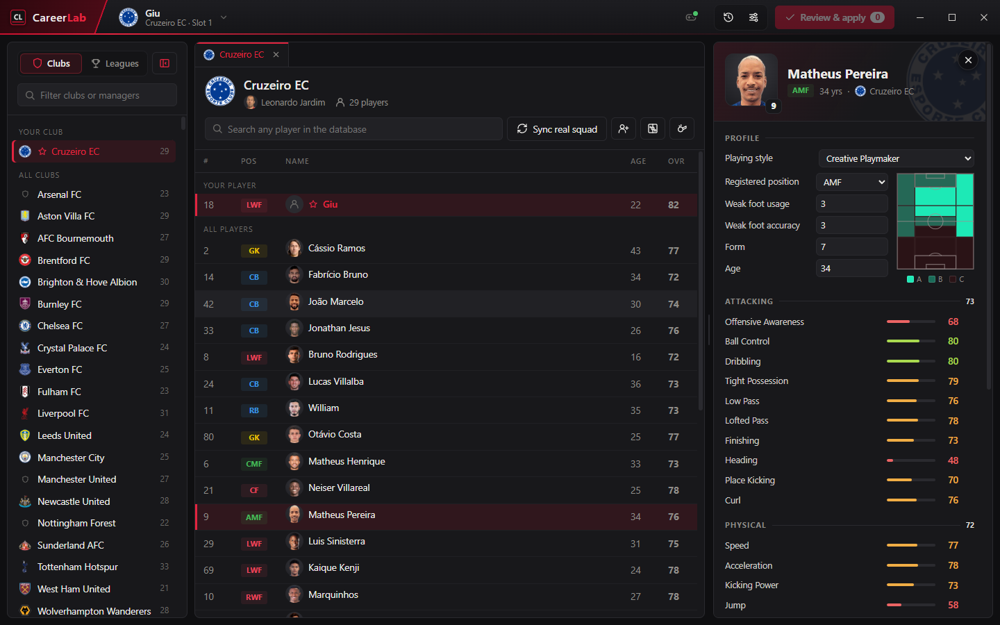
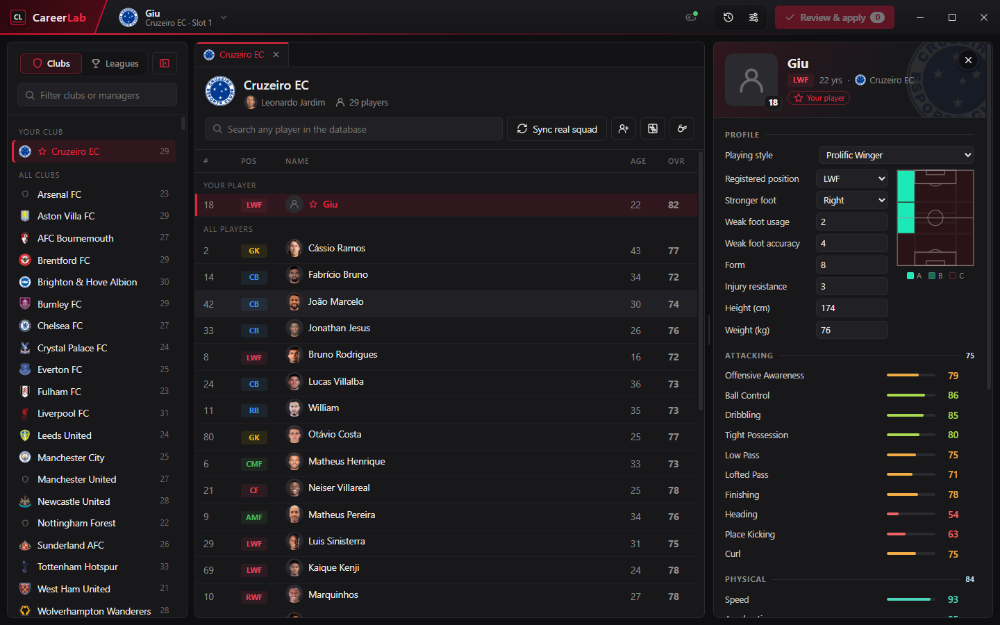
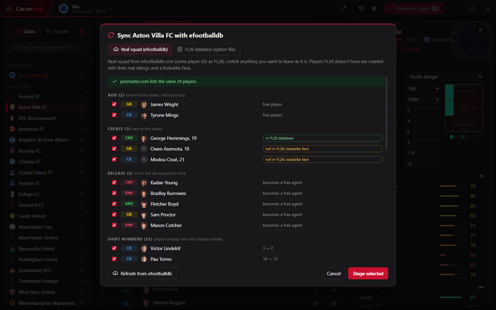
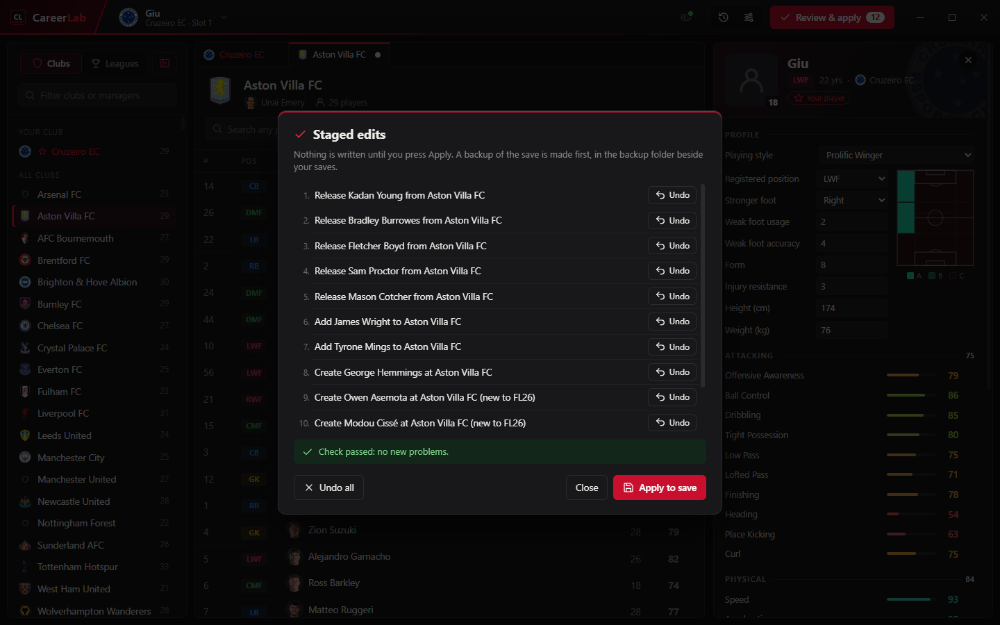
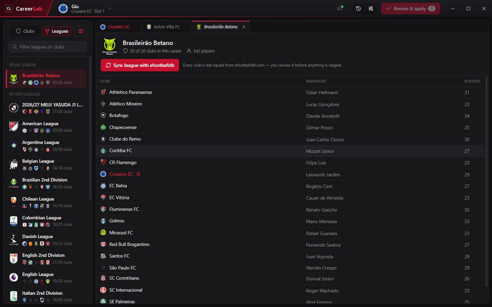
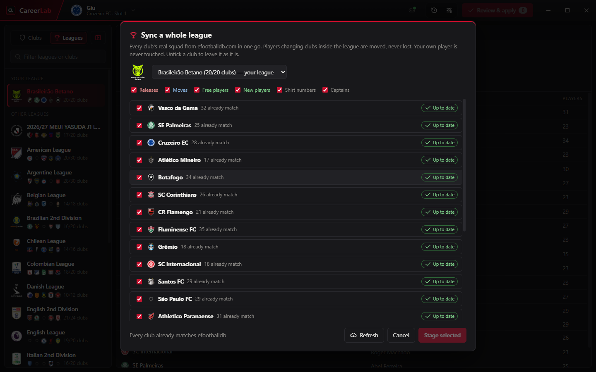
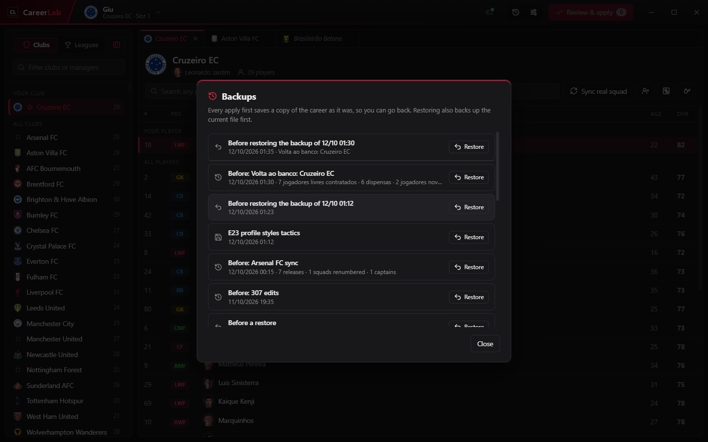
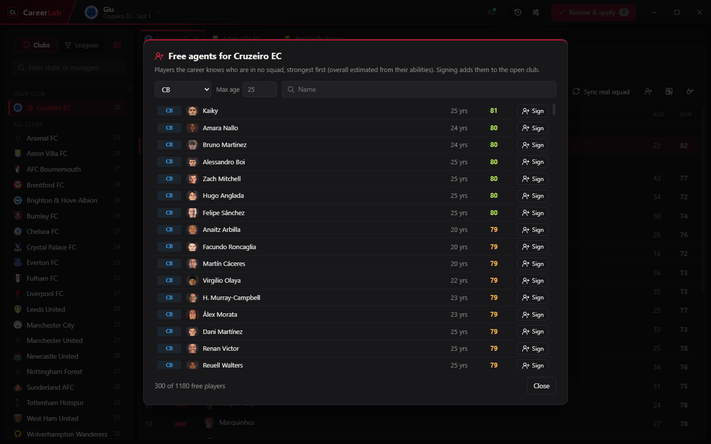
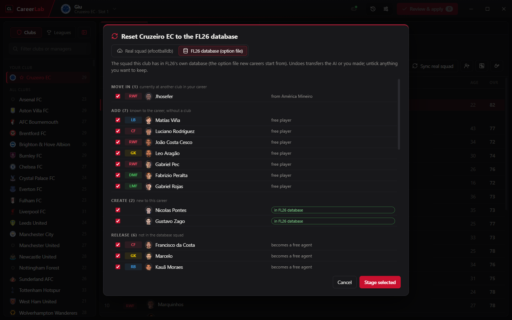
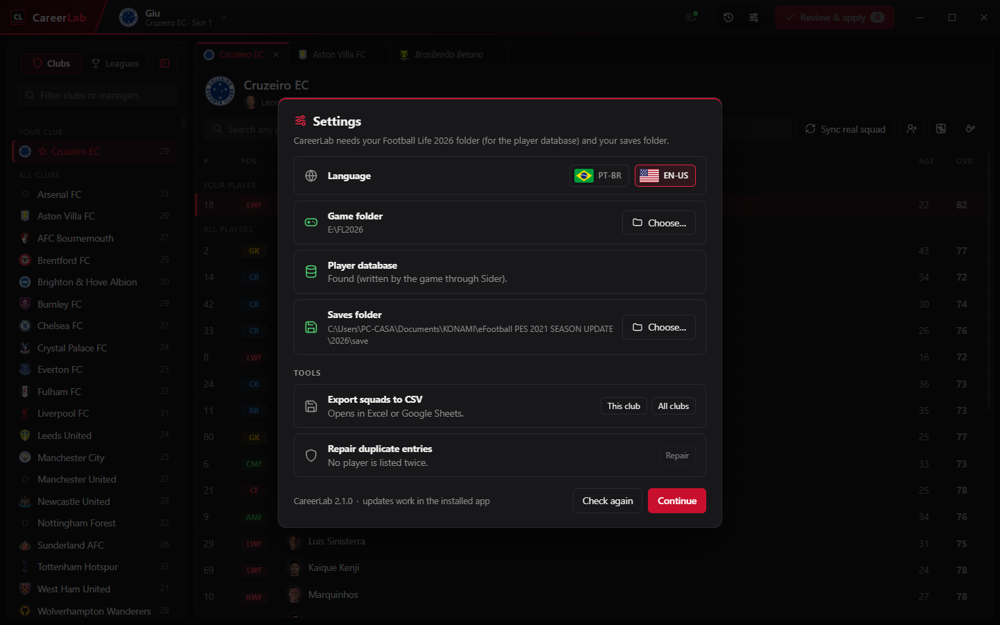

# CareerLab

**Edit a Football Life 2026 *Become a Legend* career that is already in progress**: bring
squads up to date with the real world, move and release players, create players the game
doesn't have, edit ratings and skills, change managers, and never lose a career doing it.



## What it does

- **Sync a club or a whole league** to the real squads on [efootballdb.com](https://www.efootballdb.com)
  (same player IDs as FL26): moves, free players, new players, releases, real shirt numbers
  and captains, in one reviewed batch.
- **Create players FL26 doesn't have** (academy promotions, new signings) with their real
  ratings, age, position, style and nationality, and a lookalike face.
- **Reset a club to the FL26 database**: put a squad back to the one FL26 starts careers with.
- **Sign free agents**: browse the players without a club, strongest first, and sign them.
- **Edit any player**: the 25 abilities, skills, playing style, positions (on a mini pitch),
  weak foot, form, age, shirt number, captaincy; move or release him.
- **Edit your own player**: also height, weight, best foot and injury resistance.
- **Change a club's manager**, with or without his tactics, or **copy another club's tactics**.
- **Tools**: export squads to CSV; repair the duplicate entries the game creates at season end.
- **Portuguese or English**, switched with the flags in Settings; updates itself from GitHub Releases.
- **The game's own images**: player portraits, club crests and manager photos, read from your
  FL26 install.
- **Safe by design**: nothing is written until you apply, every apply is checked and backed up,
  and the save is never touched while the game is running.

## Install

1. Download `CareerLab-Setup-<version>.exe` from [Releases](https://github.com/nsfxu/careerlab/releases/latest) and run it
   (per-user install, no admin). Windows SmartScreen may warn because the installer is not
   signed: *More info → Run anyway*.
2. On first start CareerLab looks for your FL2026 folder (the one with `FL_2026.exe`) and your
   saves folder, and asks if it can't find them.
3. CareerLab reads FL26's player database through a small read-only Sider module
   (`DBDump.lua`). If it isn't there yet, the setup screen installs it; then start the game
   once, wait for the main menu, close it, and press *Check again*.

Requirements: Windows 10/11, Football Life 2026 with Sider (it ships with the Smoke Patch).
CareerLab updates itself: when a new version is out it downloads in the background and offers
*Restart to update*.

## Using it

**Squads and players.** Pick the career slot at the top, then a club on the left (your club is
pinned first). The squad table shows an estimated overall (within about 3 points of the
game's). Click a player to open his panel: a **profile** (playing style, registered position,
weak foot, form, age, and a mini pitch where a click cycles each position between C, B and A),
abilities grouped like the game with rating bars, skills as chips, shirt number, captaincy,
move and release. For your own player (marked with a star) the profile also has height,
weight, best foot and injury resistance. Style names are exactly the game's.



**Sync a club with the real world.** *Sync real squad* fetches the club's current squad from
efootballdb and shows what would change. Untick anything you want to keep as it is. Players
FL26 lacks are created with their real ratings; players FL26 knows under another ID are
recognised by name, not duplicated. pesmaster.com is checked as a second opinion.
The **Tactics** button copies another club's formations and tactics while keeping the
manager; **Manager** swaps managers, with or without their tactics.



**Review, then apply.** Every edit is staged first. *Review & apply* lists them (undo one, or
*Undo all*), checks the edits against the save, and only then writes. Close the game before
applying: CareerLab refuses to write while it runs.



**Sync a whole league.** The *Leagues* tab beside *Clubs* lists every league of your career
(yours first) with FL26's own league emblems. Clicking one shows the league in the middle
panel, with its clubs and a *Sync league* button that plans every club of the league at once. A player who changed clubs inside the league is moved, never lost; clubs keep at
least 23 players; clubs whose real squad eFootball doesn't license (invented names) are left
as FL26 has them.



**Tabs.** Every club and league you open gets a tab over the middle panel, like a code
editor: a single click opens a preview tab that the next one replaces, a double-click keeps
it, and a dot marks clubs with staged edits. Ctrl+W closes, Ctrl+Tab switches, drag to
reorder; the tabs are remembered for each save.



**Backups** (the clock icon in the title bar). Every apply first saves the career as it was, beside your saves in a `backup`
folder. Each backup says what restoring it would undo, with the full list of edits.



**Free agents and search.** *Free agents* lists the players the career knows who are in no
squad, strongest first, filtered by position, age and name; *Sign* adds them to the open
club. The search box finds any player in FL26's database, and a player the career has never
had can be created at the open club.



**Reset to the FL26 database.** The club sync dialog has a second source: *FL26 database*
plans the club back to the squad FL26's own option file gives it, undoing transfers.



**Settings** (the sliders icon). Language (Brazilian Portuguese or English, by flag), game and saves folders,
the database reader, updates, and the tools: CSV export and duplicate repair.



## How it works

A career save refers to players by `(handle, player ID)` pairs; the handle points into a
hidden **player registry** inside the save, and the registry record decides who the player
is in that career (position, ratings, age, club). CareerLab decrypts the save, edits the
squad tables, the registry and the manager records directly, validates the result, and
re-encrypts it. Players FL26 lacks borrow the ID of an obscure database player that is
renamed in the option file. Everything was proven in game first; the evidence is in
[LIMITS.md](LIMITS.md).

## Limits

- Become a Legend only (not Master League).
- Set-piece takers can't be set: the AI manager picks them in BAL.
- The captain wears the armband only when the manager starts him.
- Players new to FL26 get a borrowed face from a player of the same nationality.
- About 2,500 new players fit in one career (registry capacity).
- Squad data is only as current as eFootball's weekly update.

## For developers (and AI assistants)

Start with [CLAUDE.md](CLAUDE.md) and [docs/](docs/): architecture, save format, testing,
data sources, build and release, and the lessons from what didn't work.

| | |
|---|---|
| `engine/fl26/` | Python engine: save format + JSON-lines RPC server |
| `app/` | Electron app (plain JS, no build step) |
| `harness/` | Drives the game and the app for verification; `readme_shots.py` regenerates these screenshots |
| `lab/` | Experiment scripts behind LIMITS.md |
| `FEATURES.md` | Feature list, status and next steps |

```
cd engine && python -m pip install -r requirements-dev.txt && python -m pytest -q
cd app && npm install && npx electron .
python build.py                      # tests -> frozen engine -> dist/CareerLab-Setup-<version>.exe
git tag v0.3.0 && git push origin v0.3.0   # GitHub Actions builds and publishes a Release
```

## License

[MIT](LICENSE). CareerLab ships no game data: it reads your own installation and edits your
own saves. Not affiliated with Konami, PES Smoke Patch, efootballdb or pesmaster; Football
Life 2026 and eFootball data belong to their owners. See [CHANGELOG.md](CHANGELOG.md).
